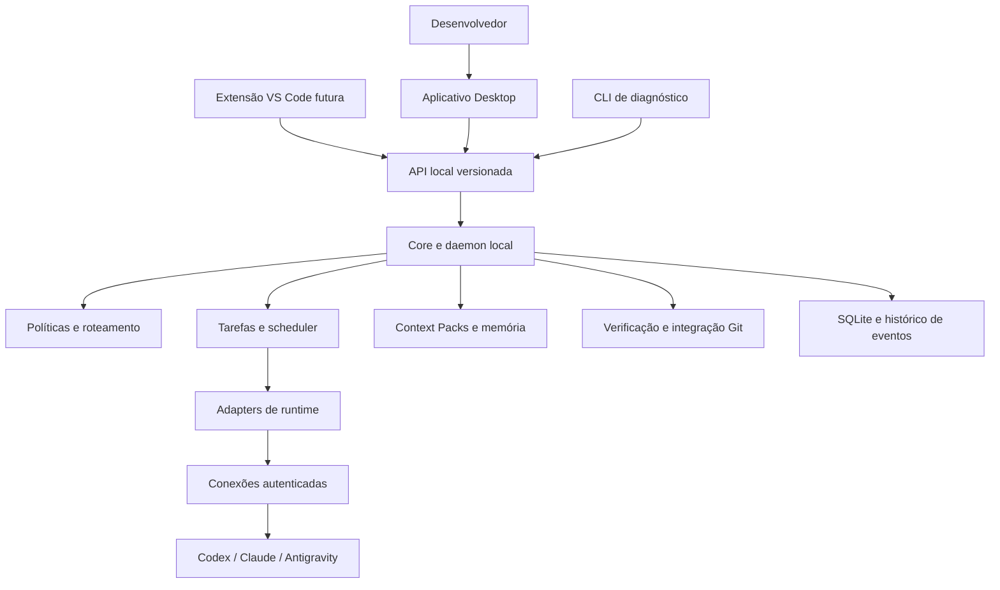

# Plano de desenvolvimento do Orchestrix

**Continuação — CAP-01, 20/10:** capacidade tipada da resposta Codex existente, diagnóstico/persistência/histórico e apresentação por conexão/preparação integrados no recorte Windows/serial. Negativa é evidência durável sem adapter executável; validade de fonte/política/reset e identidade são preservadas. O [estado atual](DEVELOPMENT_STATUS.md#incremento-atual--cap-01-capacidade-observável-no-codex) distingue campos do schema oficial, casos sintéticos, QA nativa, janela efetivamente observada em leitura autenticada e pacote normal. Não altera gates, não encerra OX-016 e mantém reservas/previsão/prioridades/transferência nos marcos existentes.

**Continuação — OX-016, retenção consultável, 20/10:** o antigo teto total de 512 transições passa a ser uma janela operacional limitada; evidências originais permanecem imutáveis e consultáveis no mesmo SQLite, com páginas e inspeção por ID/ordinal. Arquivamento preserva identidade, validade, coortes e referências antigas; reserva terminal e orçamento histórico explícito protegem continuidade e armazenamento. Provas de legado/limites/reabertura e percurso nativo sintético até 646 registros sustentam esse recorte, sem novo milestone ou acesso a conta real. O [estado atual](DEVELOPMENT_STATUS.md#incremento-atual--retenção-consultável-de-diagnósticos) separa testes, pacote e limites. OX-016 permanece parcial; CAP-01 pode avançar sobre o metadata existente, mantendo reservas/prioridades/transferência nos seus marcos.

**Continuação — OX-016, definições locais, 19/10:** recorte Windows/serial concluído com edição versionada de modos/perfis e políticas User/Project no Store/resolver existentes; seleção/preparação fixa contribuições no Context Pack e na admissão. Provas integradas e nativas com runtime sintético confirmaram contexto recebido, versões imutáveis, revisão somente leitura e reabertura sem nova execução. Formato portátil v1 preservado com remapeamento explícito, sem transportar instruções ou autorizações. Provas e pendências concretas ficam no [estado atual](DEVELOPMENT_STATUS.md#incremento-atual--definições-locais-e-resolução-por-escopo); OX-016 permanece parcial pelos demais critérios, e os fluxos representativos dos seis modos continuam no alpha/OX-017, sem nova etapa ou adiamento para M4.

**Continuação — OX-016, 19/10:** cadência/validade no daemon existente e portabilidade segura de políticas implementadas no recorte Windows/serial, sem novo milestone. Consentimento de metadata não é portátil, importações exigem remapeamento e não autorizam execução. A QA nativa comprovou configuração, rodada periódica, revogação, Recheck/cancelamento, diálogos de arquivo, remapeamento/confirmação/cancelamento de importação e HOME em 900 px/200% com dois painéis; amostras EN/PT/ES foram examinadas. Duas janelas observaram o mesmo daemon, sem afirmar corrida nativa controlada de dois pedidos. A preferência salva sem catálogo carregado recebe indicação explícita, sem virar seleção automática nem evidência de disponibilidade. O [estado atual](DEVELOPMENT_STATUS.md#incremento-atual--cadência-portabilidade-e-home) preserva falhas históricas e separa provas sintéticas, pacote e provedor real; OX-016 continua parcial pelos critérios restantes.

**Continuação — OX-012/OX-016, 17/10:** cadastro e ciclo de vida da conexão Codex gerida pelo runtime, diagnóstico compartilhado pelo daemon e seleção vinculada à preparação avançam no mesmo recorte Windows/serial. A revisão CAS do cadastro permanece distinta da revisão de vinculação; renomear preserva tentativas, enquanto desabilitar/desvincular/mudar o vínculo retira elegibilidade futura. Leitura de catálogo não confirma entitlement ou thinking aplicado; login próprio/cofre/API, cadência configurável ampliada e contas/cotas independentes não são declarados implementados. [Estado e provas atuais](DEVELOPMENT_STATUS.md#incremento-atual--conexões-geridas-e-diagnóstico) governam a passagem, preservando os aceites anteriores de instalação, revisão e aplicação. Não há novo milestone nem reabertura de D1.

**Continuação — fechamento Windows, 17/10:** controles ativos, mínimo/DPI e editor conservam suas provas; startup com histórico e Save/resposta Approved antiga foram comprovados, sem retirar gates. Examples/conformance/fronteira JS–Rust passaram na revisão combinada; demais testes permanecem associados às fontes registradas, sem repetição indiscriminada. O pacote normal final `364d2f9` foi gerado/auditado. O ciclo autorizado de backup → instalação canônica → abertura/reabertura HOME/histórico → reinstalação 0.1.0 → desinstalação preservando dados foi concluído nesta máquina/conta. Após a etapa manual final, inspeção independente confirmou remoção dos binários canônicos, atalhos e entrada Uninstall, banco com a mesma identidade e conteúdo exato da conversa/mensagem anterior (7/7 verificações). A chave de preferência do fabricante permaneceu. O aviso de janela em uso foi cancelado, preservando os processos; fechamento próprio permitiu reinstalar. Os quatro arquivos da primeira cópia redirecionada pelo ambiente continuam como resíduo separado, sem limpeza certificada. Não há prova em máquina limpa/upgrade entre versões. [Revisões, capturas, hashes e checkpoint](DEVELOPMENT_STATUS.md#incremento-atual--entrega-nativa-e-pacote-windows). OX-012/015/016/017 continuam parciais; OX-013/014 conservam seus aceites, sem novo planejamento. Naquela revisão, o próximo recorte de OX-012 era cadastro/identidade/diagnóstico da conexão oficialmente suportada, implementado posteriormente no recorte acima; o ciclo de instalação não comprova OAuth/cofre ou contas independentes.

**Checkpoint — entrega nativa e pacote normal, 16/10:** cadeia `6816d38` até Delivered/reabertura aceita no recorte sintético Windows/serial, sem repetir aplicação ou alterar o keeper de 300 s. Regressões Core `2445c5a` permanecem nas revisões registradas, com primeira falha Git preservada sem causa confirmada. A abertura pendente do pacote normal foi executada: HOME/histórico, duas janelas, editor/conflito, oito temas, três idiomas e escalas inspecionados. `70b0a02` corrige fragmentação dos rótulos de Settings/200%, com comparação nativa e matriz browser 12/12; frontend 24/24 passou. Novo NSIS normal foi gerado, auditado e aberto, sem instalar. [Fontes, evidências e próxima ação](./DEVELOPMENT_STATUS.md#incremento-atual--entrega-nativa-e-pacote-windows). OX-012/015/016 permanecem parciais: controles em turno ativo, altura mínima/DPI, startup histórico, autenticação e instalação conservam suas pendências. OX-013/014 e Antigravity não mudam de escopo.

**Histórico — diagnóstico e retomada nativa, 16/10:** `9ce4ed6` preserva códigos/estágios de falha de captura sem retry, mudança de limites ou atribuição retroativa da falha antiga. Focais Core/Git, check/Clippy workspace, conformance e frontend passaram. O payload normal anterior foi aberto nativamente: duas janelas/um daemon, editor/conflito, Continue/Suspend sem turno ativo e reabertura HOME com histórico. O produto atualizado tem build release de QA pronta, mas um novo Escape foi registrado na primeira observação após seu lançamento. A janela/daemon próprios foram preservados; [checkpoint executável e evidências por fonte](./DEVELOPMENT_STATUS.md#incremento-atual--diagnóstico-de-captura-e-retomada-nativa). Retomar a janela existente para a cadeia até Delivered; depois concluir os casos nativos restantes e gerar/abrir novo pacote normal. Instalação continua não validada. OX-012/015/016 permanecem parciais, OX-013/014 conservam seus aceites Core e Antigravity não muda de situação. Sem replanejamento ou novo escopo.

**Histórico — QA nativa e Antigravity, 15/10:** a continuação de `14f28d1` percorreu o Desktop até implementação Verified/revisão Rejected; a correção terminou Uncertain antes da captura, sem causa Git específica preservada. Inspeção somente leitura não reproduziu o erro. Novo Escape interrompeu a interação; [evidências, capturas e próxima ação](./DEVELOPMENT_STATUS.md#incremento-atual--qa-nativa-e-avaliação-antigravity) preservam a falha sem retry ou Delivered fictício. Ajustes observados de estados/revisão/recuperação passaram no frontend; o preflight PowerShell corrigido impede staging sobre a QA carregada. NSIS normal anterior está preservado; produto atualizado, abertura normal e instalação ainda não foram validados nativamente. OX-013/014 conservam seus aceites Core anteriores; OX-012/015/016 permanecem parciais. A [investigação delimitada Antigravity/OX-002](./research/antigravity-runtime-assessment.md) documenta a CLI oficial, mas não libera adapter por assinatura sem esclarecer termos, isolamento e overage; Claude não bloqueia esse caminho. Retomar QA e diagnosticar captura são os próximos passos, sem reabrir D1 ou expandir milestones. Os registros abaixo preservam as entregas anteriores.

**Histórico — OX-010/011 concluído no recorte Windows, 15/10:** API local/daemon e CLI compartilham comandos versionados, journal/eventos/cursor e controles determinísticos; recuperação reconcilia antes da admissão e reconstrói contexto básico sem modelo. O commit `1ccc0b7` passou os seis cenários integrados com runtime sintético, Git/SQLite/processos reais, com evidências da matriz de recuperação em 14 pontos preservadas por revisão. A correção final `e828a7f` restringiu intervenção em registros V4 e passou seis casos focais, catálogo de sete modelos e recuperação pela API com nova tarefa verificada. [Contrato](./contracts/local-daemon.md), [evidências por revisão](./research/local-daemon-recovery-increment.md) e [status](./DEVELOPMENT_STATUS.md) distinguem falhas anteriores, regressões e limites. [Capacidade preventiva, prioridades e continuidade](./design/capacity-and-continuity.md) estão formalizadas e apresentadas no site em inglês; telemetria completa, reservas por papel, priorização multiagente e transferência efetiva permanecem planejadas. Próximo incremento liberado: OX-012, sem iniciar Desktop neste lote. M0 e os demais gates conservam suas pendências.

**Histórico — lote OX-007/008/009 aceito, 14/10:** política/contexto determinísticos, supervisor Rust Codex e worker manual estão integrados no recorte Windows, uma assinatura e execução serial. A [prova live R9 em `66918b1`](./research/manual-worker-increment.md#r9-authorized-live-acceptance) passou os três turnos autorizados: edição/check em fixture isolada pelo worker Rust, reinício/retomada com contexto e cancelamento após início confirmado. Resultado durável Verified/Task NeedsReview, sem aplicação ou entrega; CLI `status` reabriu a mesma tentativa. A execução completa pela CLI conserva sua prova com runtime sintético. As regressões e falhas históricas permanecem vinculadas às revisões originais. [Contrato](./contracts/manual-worker.md), [evidências e tempos](./research/manual-worker-increment.md) e [status](./DEVELOPMENT_STATUS.md) preservam limites de capacidades, Git e plataformas. Naquela entrega, OX-010 era o próximo incremento liberado; sua continuação está registrada acima. OX-003 a OX-006 conservam seus recortes, D0/D1 não reabrem e M0 não está concluído. Revisão/integração final continuam OX-013/OX-014; os registros seguintes preservam seu contexto histórico.

**Alinhamento de produto — 13/10:** [registro das definições explícitas](./design/product-alignment-2026-10-13.md), distinguindo requisitos existentes, esclarecimentos e a nova atualização periódica/event-driven de capacidades. A direção é Desktop open source, conversa com orquestrador selecionável e editor auxiliar, sem evolução presumida para IDE. Windows, macOS e Linux têm entrega/validação progressivas; [ADR-0005](./adr/0005-desktop-product-scope-and-platform-boundaries.md) esclarece escopo e preserva Desktop + Core. Este alinhamento não implementa funcionalidades nem altera os gates.

**Incremento técnico atual de M0 — 13/10:** a [bridge Windows](./research/windows-process-containment.md#integração-do-transporte--1210) e a [comparação CLI](./research/cli-app-server-comparison.md) passaram a nova rodada explicitamente autorizada de **cinco turnos reais**, após a correção de `SYSTEMDRIVE`. App-server demonstrou edição/cinco checks, reinício/retomada e força do Job durante turno próprio; CLI demonstrou edição/checks e retomada exata. **App-server foi escolhido como primeiro adapter, aprovado no recorte local de uma assinatura autenticada**, liberando o início de OX-003. A rodada anterior de dois turnos bloqueados e a prova determinística permanecem preservadas. OX-001 conserva diagnóstico completo/OAuth próprio pendentes; OX-002, M0 e avaliação externa continuam abertos. Evidências e próximos entregáveis no [status](DEVELOPMENT_STATUS.md); os parágrafos seguintes conservam as entregas históricas.

**OX-003 concluído no recorte local single-account — 13/10:** [contrato wire 1.1](./contracts/runtime-contract-v1.md), fake/adapter Codex e [consumidor Core Rust](../crates/orchestrix-core/README.md) passam a [conformance e aceite](./research/portable-runtime-input-increment.md) de **245 casos/935 operações**. O [perfil portátil revision 1](./contracts/runtime-input-profile.md) resolve timestamps/JSON com compatibilidade explícita, sem aceitar `Date.parse` ambíguo, adivinhar fuso ou alegar aceitação de todo input legado. Os 104 casos anteriores permanecem idênticos. Rust/Cargo 1.99.0 e MSVC/SDK existentes foram reutilizados; houve somente trabalho offline. **Próximo incremento: OX-004 domínio/estados**, liberado pelo contrato estabilizado, sem antecipar SQLite/scheduler/worker nesta rodada. M0/OX-001/OX-002 e diagnóstico/OAuth/contas independentes conservam seus gates. [Fixtures/replay anteriores](./research/codex-contract-integration.md) mantêm catálogo/ACK/processos desconhecidos quando faltam vínculos.

O Orchestrix deve permitir que o desenvolvedor defina um objetivo, conecte seus agentes de código e acompanhe um sistema que planeja, distribui, verifica e integra o trabalho. A escolha de conta, runtime, modelo, esforço de raciocínio e contexto deve seguir políticas configuráveis e produzir decisões explicáveis.

O caminho proposto começa por pesquisa aprofundada de soluções semelhantes e experiência de uso. Essa pesquisa orienta uma execução confiável e um aplicativo com identidade visual, organização clara e conforto para desenvolver. A autonomia cresce sobre essa base. Múltiplas contas do mesmo provedor fazem parte do domínio desde o início; sua execução simultânea depende das capacidades e condições de integração de cada runtime.

**Estado em 12 de outubro de 2026:** D0 está concluído como pesquisa, com [conclusão, decisões e revisão explícita do critério metodológico](./research/d0-conclusion.md). D1 tem a [revisão de sessões, painéis e Settings](./design/d1-shell-revision.md), com entrada progressiva e identidade aprovada. A rodada histórica anterior à revisão passou **77/77**; a verificação da nova versão consta na [execução do plano](./DEVELOPMENT_STATUS.md). O resultado anterior de 73 casos por cobertura consolidada permanece histórico. A [pasta de padronização visual](../design-system/README.md) orienta as próximas implementações; aprovação estética e testes técnicos não encerram o piloto humano. Em 12/10, o responsável reportou execução favorável, exceto pelo docking; após a correção técnica, confirmou “Passei pelo reteste e funcionou”. D1-FB-01 está resolvido e o gate piloto foi liberado para M0, conforme o [registro e a decisão de passagem](./design/d1-pilot.md#piloto-reportado-pelo-responsável--1210). As condições P0 indisponíveis e a avaliação externa permanecem pendentes nos tickets integrados, sem aprovação por agregação. O status também registra o [primeiro percurso real Codex](./research/runtime-harness-results.md) antecipado, a [preparação offline de lifecycle](./research/offline-lifecycle-validation.md) e [nove testes nativos de contenção/watchdog Windows](./research/windows-process-containment.md). Autenticação via assinatura, resposta e interrupção foram observadas no primeiro harness. O [live de 12/10](./research/m0-live-validation-2026-10-12.md) preserva a primeira tentativa bloqueada e registra a segunda autorização MXC aprovada: edição pelo modelo com cinco checks/diff, reinício/retomada da mesma thread com política de escrita e interrupção do turno confirmados. O harness usado passou 95/95 offline na revisão anterior. Supervisão da árvore real, comparação CLI e contas independentes permanecem pendentes; novas inferências continuam opt-in. A preparação offline não amplia capacidades reais do provider; a retomada de M0 decorre da passagem humana registrada, não das fixtures. O aplicativo de produção ainda não está implementado. Os [ADRs 0001 a 0004](./README.md#architecture-decision-records) continuam sendo as decisões aceitas; o [backlog](./DEVELOPMENT_BACKLOG.md) mantém os gates de piloto e implementação.

**Continuação atual em 12/10:** as correções solicitadas no piloto foram entregues e verificadas: docking mantém o único Workspace no lado escolhido; o composer reúne contexto no +, modelo/modo por sessão e rolagem ao final; projetos têm ações explícitas e compactas. O reteste humano confirmou o docking; retomar OX-001 com as lacunas P0 preservadas. Priorizar superfície de integração, retomada real, alteração em worktree descartável, diff/checks da tentativa e supervisão/cancelamento no Windows. Não é necessário concluir todos os provedores antes do primeiro worker. A navegação usa árvore de sessões/projetos em vez de dois seletores. Sessões começam avulsas ou dentro de um projeto e podem ser vinculadas preservando identidade, histórico, rascunho e snapshots antigos. A [barra fixa de atividades](./design/activity-shell-revision.md) fica à esquerda, com Chat, Files, Studio e Connections reordenáveis e Help, Settings e Profile na base. Chat abre diretamente a conversa sem painel lateral próprio; Files, Studio e Connections abrem seu painel à esquerda por padrão. Sessions permanece independente à direita, com um único criador principal. Painéis movem-se entre esquerda/direita, compartilham abas e recolhem pela divisória; o workspace recebe blur durante a escolha de lado. Menus File/Edit/View/Help oferecem ações do aplicativo. Files acrescenta árvore e edição leve de texto/Markdown mediante acesso concedido, sem execução de IDE. A entrada Compact foi reduzida para caber em telas comuns de notebook a 100%. Settings flutuante abre centralizada, maior, fecha ao clicar fora e mantém o rascunho da conversa e reúne perfil, idioma, Themes, contas/uso observado, créditos de API quando expostos, instruções pessoais e políticas. Help abre tutoriais ilustrados no navegador, com estrutura para vídeos futuros. A apresentação evita demo/exemplo/local-first; capacidades de execução e dados de provedores continuam sujeitos aos contratos reais, com desconhecido explícito. O [padrão do shell](../design-system/workspace-shell.md) orienta o Desktop de M2. A conexão começa por Subscription/API, depois provedor, com campos condicionais para Gemini, Azure AI, AWS Bedrock e APIs compatíveis. A [pesquisa oficial](./research/api-provider-discovery-2026-10-10.md) e o [contrato](./design/api-connection-contract.md) orientam descoberta/capabilities em OX-002/OX-003 e conexões de OX-016, sem prometer APIs indisponíveis ou telemetria. Compact é padrão; tamanho de texto usa range percentual. Marcos e gates existentes permanecem.

**Incremento de descoberta imediata (10/10):** [catálogos de recursos e controles padronizados](./design/resource-discovery-increment.md) acrescentam a bridge de leitura ao host de desenvolvimento. Salvar uma API consulta o catálogo específico do backend e registra capacidades com origem/escopo, unknown e parcialidade, sem prompts pagos. A entrega prepara OX-002/OX-003/OX-007/OX-016; login, cofre, execução e gates existentes permanecem.

**Incremento de diagnósticos (10/10):** o [contrato de diagnósticos de conexões](./design/connection-diagnostics.md) acrescenta várias verificações automáticas no cadastro e uma ação de recheck, adequadas ao tipo de conexão e provedor. O relatório separa suporte, configuração/política, disponibilidade e evidência observada, com progresso, bloqueios e dados desconhecidos. Modelo, reasoning/thinking, Fast/Ultrafast, multi-agent nativo e acesso completo são verificados separadamente; Ultra pode incluir delegação no produto do fornecedor, mas seu nome não certifica a combinação efetiva de um adapter. Azure conserva catálogo e deployments/ARM separados; Bedrock considera região, autenticação e inference profiles; Gemini API permanece distinto de Antigravity. Nesta etapa, o diagnóstico lê metadata/configuração autorizadas e não executa prompts, ferramentas ou probes pagos. Runtime sem identidade/adapter validado permanece bloqueado ou desconhecido.

A continuação usa os tickets existentes: OX-001/OX-002 validam leituras e futuras provas controladas por runtime; OX-003 consolida o relatório normalizado; OX-007/OX-008 aplicam a política efetiva por tentativa; OX-012/OX-016 levam cadastro, progresso, inspeção e recheck ao Desktop. Enquanto o Orchestrix coordena workers, delegação nativa aninhada fica desativada por padrão na sua política, sem modificar a configuração pessoal do runtime durante o diagnóstico. Uma opção futura exigirá escopo, benefício e orçamentos definidos. Probes ativos são evolução posterior, com limites e autorização de efeitos/cobrança; Subscription Only continua vedando execução API e fallback pago. O piloto D1 e o reteste favorável foram reportados em 12/10; o gate piloto está liberado para M0, com as condições P0 indisponíveis destinadas à integração e avaliação nos tickets existentes, sem considerá-las aprovadas. Nenhum relatório de leitura conclui M0 ou muda a ordem D0 → D1 → M0 → M1 → M2.

## 1 Objetivo de produto

O usuário deve poder abrir um repositório, conectar uma ou mais contas próprias e conversar com um agente orquestrador selecionável, pedindo algo como: “implemente autenticação e faça uma revisão de segurança”. O Orchestrix prepara um plano, mostra suas escolhas, executa tarefas em ambientes separados, encaminha resultados entre agentes, roda verificações e apresenta a integração para aprovação conforme a política do Core. Um padrão útil permite começar sem copiar instruções entre workers ou configurar todos os parâmetros.

O Desktop é um workspace de desenvolvimento assistido: o usuário formula trabalho, fornece contexto, examina código/diffs e pede correções dentro do aplicativo. A qualidade visual e a adaptação da interface fazem parte do produto desde o primeiro alpha. A direção de 12/10 inclui árvore de arquivos, edição leve de texto e leitura de Markdown para ajustes como `.env` e documentação, sem assumir o escopo de IDE, debugger ou ambiente integrado de testes. Acesso e escrita exigem concessão explícita; editar uma cópia importada não equivale a salvar no projeto. As verificações executadas pelo Core continuam produzindo evidências para revisão.

O [editor auxiliar](./DESKTOP_APP_AND_PROJECT_WORKSPACE.md#7-supporting-editor-and-diff-viewer) inclui realce por linguagem, prévia Markdown/diff, salvar/desfazer e alterações não salvas, com comparação de versão/base para preservar edições concorrentes e impedir aprovação de artefato antigo. IDE, debugger, test explorer, terminal interativo embutido, ambiente interativo de execução de projetos e ecossistema de extensões de IDE estão fora da direção atual, inclusive como evolução presumida. Abrir editor/terminal externo é facilidade opcional; iniciar/supervisionar agentes, operar Git e executar checks autorizados continua sendo função interna do Core.

O refinamento de Files separa arquivos de sessões: o menu **File** contém **Open file, Open folder e New file**, sem criar sessão/projeto ou concentrar salvar/fechar. Abrir arquivo avulso não exige uma pasta. Criar arquivo de texto com nome/extensão requer escolher o destino na pasta autorizada ou, se nenhuma estiver aberta, conceder acesso à pasta de destino; a criação é explícita e não sobrescreve um arquivo existente. D1 demonstra essas entradas dentro dos limites do navegador, distinguindo arquivo criado de rascunho/cópia. O ciclo Desktop de alterações não salvas permanece em M2.

A entrada é pelo chat. Toda abertura, reload ou reabertura apresenta HOME, sem restaurar automaticamente a sessão antes ativa. HOME e New session preparam um composer pendente, avulso ou em projeto; a sessão só é salva no primeiro envio não vazio. Um projeto pode ter zero ou várias conversas e contexto compartilhado; associar uma conversa existente depois preserva identidade, histórico e tentativas anteriores. Histórico e rascunhos de sessões salvas continuam disponíveis por reabertura manual, enquanto o composer antes do primeiro envio é temporário em memória e não recuperado após reload. A árvore de Sessions substitui seletores sobrepostos. A [direção de chat](./design/d1-chat-direction.md) e o [contrato do shell](../design-system/workspace-shell.md) definem a divulgação progressiva: ações frequentes próximas da conversa, Studio e detalhes técnicos conforme a necessidade, Settings flutuante e tutoriais externos. O protótipo browser demonstra essa direção; a implementação Desktop continua em M2.

Três configurações devem usar o mesmo núcleo:

| Configuração | Comportamento esperado |
| --- | --- |
| Uma conta Codex | Planejamento, implementação e revisão em sessões separadas, respeitando a capacidade da conta. |
| Duas contas Codex | Seleção entre conexões autenticadas distintas, com disponibilidade e limites próprios quando confirmados pelo provedor. |
| Codex, Claude e Antigravity | Distribuição por papel, capacidade, preferência, disponibilidade e política de revisão. |

Mais sessões não significam mais cota. Mais contas também não garantem limites independentes: o sistema precisa representar grupos de capacidade compartilhada quando existirem. Uma sessão existente permanece vinculada à conexão que a criou; trocar de conta ou provedor inicia uma nova sessão com um novo Context Pack.

Uma assinatura, um runtime e até um único modelo devem constituir uma configuração útil, com trabalho serial quando necessário. A seleção automática ajusta somente controles realmente expostos; ausência de modelos alternativos não impede uso do chat, contexto, papéis e verificação. APIs próprias são outra modalidade, com autorização e cobrança independentes. O [contrato de conexão](./design/api-connection-contract.md) mantém o cadastro em duas etapas e a possibilidade de inspecionar recursos sem liberar execução paga.

Development continua sendo o uso principal. A versão inicial desejada contempla também Research, Documentation, Presentations, Refactoring e Improvement Review, com critérios adequados aos artefatos e suporte das ferramentas demonstrado. Modos especializados e configuração dos perfis executores seguem o [contrato de modos e perfis](./design/action-modes-and-worker-profiles.md); a apresentação do catálogo não comprova que esses fluxos já foram entregues.

A autonomia terá três níveis configuráveis: acompanhamento manual de tarefas; execução de um plano aprovado; planejamento e replanejamento dentro dos limites autorizados pelo usuário. Em todos eles, o Core mantém a autoridade sobre estado, permissões e integração.

## 2 Decisões existentes e ajustes necessários

As decisões aceitas já sustentam o produto: um único runtime é suficiente; modelo e thinking são políticas centrais; Desktop e futuras extensões usam um Core independente do editor; o provedor mantém sua conversação e o Orchestrix mantém o conhecimento durável do projeto.

Para tornar essa visão executável, o desenvolvimento precisa corrigir seis lacunas:

1. Levar o cadastro de conexões distintas do protótipo ao domínio seguro de produção, preservando identidade, modalidade de autenticação e cobrança.
2. Tarefa, tentativa, sessão e integração precisam ter estados separados.
3. Política, contexto básico, eventos e recuperação devem existir no primeiro fluxo útil.
4. A interface deve acompanhar o primeiro ciclo de implementação e revisão, antes da inteligência avançada.
5. Revisão com outro provedor deve ser uma preferência ou exigência explícita, preservando o funcionamento com um único runtime.
6. Pesquisa de similares, arquitetura de informação, design visual e validação de uso devem orientar a interface antes de sua implementação.

As 23 fases do [roadmap](./ROADMAP.md) permanecem um inventário de capacidades. A sequência de entrega proposta neste plano agrupa essas capacidades em resultados utilizáveis.

## Pesquisa inicial de solução e experiência

**D0 Pesquisa de produto:** estudar soluções de orquestração, runtimes/frameworks integráveis e referências de interação desktop. Comparar capacidades, arquitetura, contas, contexto, revisão, integração, recuperação e manutenção. Percorrer jornadas e reunir referências visuais anotadas; registrar o que adotar, adaptar ou descartar com evidência e motivo.

**D1 Design e validação:** criar jornadas, arquitetura de informação, wireframes e duas ou três direções visuais. Selecionar uma direção e produzir protótipo de alta fidelidade, tokens e estados de interface. Avaliar compreensão, conforto e capacidade de concluir o fluxo; corrigir problemas críticos antes de implementar o Desktop.

O [levantamento e pesquisa aprofundada](./PRODUCT_AND_UX_RESEARCH.md) consolidado em 08/10 reúne nove famílias: Conductor, Codex, Superset, Vibe Kanban, cmux, OpenHands, Cline, OpenCode e Antigravity, além de Linear, Raycast, GitHub Desktop e Fluent 2. A [conclusão de D0](./research/d0-conclusion.md) liga documentação, capturas e demos a prioridades e lacunas. É um benchmark de pesquisa, sem avaliação de produtividade/usabilidade dos concorrentes ou validação do design do Orchestrix.

O [complemento competitivo de 09/10](./research/competitive-update-2026-10-09.md) acrescenta Jackalope/Cobalt e evidência de múltiplas contas no Superset, ampliando o levantamento documental para onze famílias. A proposta central já tem concorrentes diretos. O plano deve avaliar vantagem em coordenação, compreensão, conforto e qualidade das decisões, conforme CMP-01 a CMP-05 e o protocolo comparativo proposto. OX-D05 valida entendimento; OX-017 permite medir execução; M3/M4 permitem comparar contas/roteamento. Essas hipóteses não acrescentam gates nem antecipam implementação.

A [biblioteca local de referências técnicas](./research/REFERENCE_REPOSITORIES.md) complementa a pesquisa sem reabrir D0. Consultar o componente relacionado ao ticket quando surgir um problema de engenharia, registrando commit, arquivos, decisão e limites; licenças e atribuição devem ser verificadas antes de qualquer reutilização. O catálogo não acrescenta funcionalidades, milestones ou requisito de auditar todos os projetos.

A sequência principal é **D0 → D1 → M0 → M1 → M2**, seguida de M3 a M6. D0 foi consolidado; D1 aplicou seus resultados às jornadas e ao protótipo verificado. Em 12/10, o piloto geral favorável e o reteste após corrigir a falha de docking liberaram o gate piloto para retomar M0. O [registro da passagem](./design/d1-pilot.md#piloto-reportado-pelo-responsável--1210) conserva os resultados desconhecidos dos P0 e seu impacto: serão demonstrados na integração, sem aceite do alpha ou produção. Retomar OX-001 com o harness existente; o candidato de [autorização própria para uso do plano ChatGPT](./research/subscription-account-ux.md) continua no escopo de M0. A avaliação externa permanece em OX-017. Protótipo, diagnósticos de leitura e harness antecipados não concluem a viabilidade de M0. Dentro de cada marco, tarefas independentes podem avançar em paralelo.

## 3 Arquitetura de entrega



Manter a base em [TECH_STACK.md](./TECH_STACK.md): Rust, Tokio, SQLite e Git CLI no Core; Tauri, React e TypeScript no Desktop. Os componentes ainda propostos exigem seus spikes/gates. A biblioteca SQLite foi escolhida no [ADR-0006](./adr/0006-synchronous-sqlite-persistence.md): rusqlite com SQLite embutido, validado em OX-005 por migração, rollback, reabertura e duas conexões. Isso não implementa Tokio, Git ou o Desktop.

Windows, macOS e Linux são plataformas pretendidas de distribuição, com Windows primeiro permitido e sem lançamento simultâneo prometido. A [matriz de aceite por sistema](./TECH_STACK.md#platform-boundaries-and-progressive-delivery) governa suporte progressivo em OX-003/OX-007/OX-012/OX-015/OX-017 e M5. Processos, arquivos, credenciais e integrações específicos de OS ficam na infraestrutura/host/adapters; domínio e contrato de runtime permanecem portáveis. Uma prova Job Windows não certifica contenção nos outros sistemas.

Começar com poucos pacotes: `orchestrix-core`, módulos de infraestrutura/adapters, `orchestrix-daemon` e `apps/desktop`. Políticas, domínio, contexto, scheduler e verificação são módulos com limites explícitos; não precisam nascer como serviços separados. Extrair crates quando houver benefício concreto de testes, dependências ou reutilização.

O daemon será o proprietário dos processos e do banco. Desktop e CLI chamam comandos e consultas da mesma API de aplicação. Tipos do domínio não dependem de Tauri. Um transporte local versionado, com acesso restrito ao usuário, oferece comandos identificados, snapshots e eventos com cursor. Isso prepara a extensão VS Code sem implementá-la antecipadamente.

Descoberta e diagnósticos são operações de leitura dos adapters, separadas da execução de tarefas. O host controla credenciais, destinos e limites; o renderer recebe resultados sanitizados. A bridge JavaScript do estudo e o armazenamento de sessões/rascunhos do navegador não substituem cofre, SQLite, identidade de processo ou recuperação de produção. Levar os contratos validados ao Core nos marcos existentes.

## 4 Modelo de domínio para múltiplas contas

| Conceito | Responsabilidade |
| --- | --- |
| Project | Reúne contexto compartilhado, repositório e referências de trabalho, sem ser a identidade de uma conversa. |
| Conversation | Sessão de chat do aplicativo, avulsa ou associada a um projeto; referencia trabalho e artefatos sem fundir sessões nativas. |
| Provider | Identifica a plataforma, como OpenAI, Anthropic ou Google. |
| RuntimeAdapter | Implementa o contrato de integração e traduz capacidades e eventos. |
| RuntimeInstallation | Guarda executável, versão detectada e estado de instalação. |
| Connection | Vincula instalação, referência de conta, autenticação selecionada e modo de cobrança. |
| CapacityGroup | Representa limites compartilhados entre conexões, quando conhecidos. |
| AgentProfile | Define papel, permissões e preferências de modelo, raciocínio e contexto. |
| ExecutionRun | Agrupa a execução de um objetivo e suas revisões de plano. |
| Task | Guarda objetivo, dependências, critérios de aceite, risco e resultados necessários. |
| TaskAttempt | Registra uma tentativa, revisão do plano, política efetiva, conexão, contexto, base, worktree e evidências. |
| RuntimeSession | Referencia a conversação do provedor, vinculada à conexão original. |
| ConnectionDiagnostics | Snapshot versionado de verificações, recursos e evidências da identidade/escopo de uma conexão. Não autoriza execução. |
| IntegrationAttempt | Registra aplicação do resultado sobre uma base e sua verificação final. |

`codex-pessoal-a` e `codex-pessoal-b` são duas Connections que usam o mesmo adapter. Implementador e revisor são perfis, e podem usar qualquer conexão elegível. Identidade da conta e papel do agente permanecem conceitos separados.

O registro de conexões e as referências de autenticação ficam no estado local da aplicação. A política compartilhável do projeto guarda IDs e preferências, sem credenciais. Ao importar uma política, validar e remapear essas referências explicitamente antes de executar; um ID de outra instalação não autoriza selecionar uma conta local diferente. Usar autenticação oficial do runtime e armazenamento seguro do sistema operacional onde aplicável; não extrair tokens para redistribuição nem colocar segredos em eventos.

## 5 Escolha de conta, modelo e thinking

O primeiro router deve ser determinístico. Primeiro elimina candidatos incompatíveis com requisitos obrigatórios: autenticação, modo de cobrança, permissões, capacidades, exigência de revisão e capacidade de execução. Depois aplica preferências ordenadas e disponibilidade. Histórico de desempenho entra apenas quando houver dados suficientes.

A seleção produz um registro com candidatos considerados, razões de exclusão, conexão escolhida, modelo solicitado e efetivo, reasoning solicitado e efetivo, service tier e fallback. Quando o runtime não confirma um parâmetro efetivo, o registro mostra `unknown` ou `runtime-managed`. Consultar capabilities e acesso no escopo e revisão corretos; uma união de capacidades no resumo do diagnóstico não concede todas elas a cada modelo.

**Requisito novo de 13/10:** além do cadastro/Recheck, aplicar a [política de atualização periódica e orientada a eventos](./design/connection-diagnostics.md#atualização-periódica-e-orientada-a-eventos--requisito-planejado), com intervalo/validade configuráveis, reconexão e mudança de identidade/configuração/versão, revalidação dirigida por erros e consulta às capacidades necessárias antes de nova execução. Reutilizar cache válido, agrupar consultas e limitar frequência/concorrência com backoff; não fazer inventário completo por mensagem. Requisito obrigatório vencido exige revalidação ou bloqueio. Falha de consulta não comprova recurso ausente; mudanças confirmadas afetam novas escolhas com explicação, preservando snapshots ativos. Nenhuma inferência/ferramenta/probe potencialmente cobrado roda automaticamente para preencher lacunas.

Para preferências, manter a precedência já proposta: sistema → usuário → projeto → perfil → categoria/risco → execução → tarefa. Restrições obrigatórias formam um conjunto de limites que overrides não podem ampliar sem autorização da política. Resolver conflitos explicitamente; uma preferência nunca remove uma obrigação.

As estratégias iniciais são **Efficiency, Performance, Balanced e Custom**, conforme a [direção de roteamento](./design/routing-strategies.md):

| Estratégia | Intenção |
| --- | --- |
| Efficiency | Preservar capacidade/cotas, usando modelos e esforço menores quando suficientes para a complexidade, risco e importância da tarefa. |
| Performance | Priorizar qualidade e modelos adequados ao trabalho exigente, sem elevar reasoning em verificações triviais ou determinísticas. |
| Balanced | Equilibrar qualidade, tempo e utilização da assinatura com regras explicáveis. |
| Custom | Permitir ajustar regras, preferências e limites pelos escopos da política. |

Presets especializados, como Scientific Research, Software Architecture, Complex Planning, Debugging e Security Review, refinam a configuração para um domínio. Modo de ação, perfil do executor e estratégia de recursos permanecem conceitos distintos. Cada preset é inspecionável e personalizável; não libera uma ferramenta ou uma modalidade de cobrança proibida. O controle manual conserva prioridade dentro das restrições obrigatórias.

“Modelo mais forte” usa uma ordem explicitamente fundamentada ou configurada, sem ranking universal inferido pelo nome/preço. A intenção `maximum` se traduz para um valor nativo aceito naquela combinação e não implica que mais esforço sempre produza resultado melhor. A V1 usa regras determinísticas por tipo, complexidade, risco, importância e contexto; classificadores sofisticados e otimização por histórico evoluem depois. Consultas mecânicas, como status do Git, usam a ferramenta determinística autorizada, sem chamada de modelo quando ela não é necessária.

Exemplo conceitual de política de projeto, ainda sem contrato público estável:

```yaml
execution:
  allowedConnections: [codex-pessoal-a, codex-pessoal-b, claude-pessoal]
  subscriptionOnly: true
  allowApiFallback: false
routing:
  implementation:
    preferredConnections: [claude-pessoal, codex-pessoal-a]
    reasoning: high
  review:
    preferredConnections: [codex-pessoal-b, codex-pessoal-a]
    reasoning: maximum
review:
  requireFreshSession: true
  preferDifferentProvider: true
  requireDifferentProvider: false
```

Na execução, a política vira um snapshot imutável. Alterações ao vivo afetam novas decisões e emitem eventos; reduzir concorrência impede novas admissões até atingir o limite, sem encerrar automaticamente trabalhos ativos. Uma exigência sem candidato elegível deixa a tarefa bloqueada com uma explicação.

O modo de assinatura precisa verificar a origem da autenticação e eventuais fallbacks do runtime. Remover variáveis de API é apenas uma parte dessa verificação. Se o modo de cobrança não puder ser confirmado, uma política estrita não inicia a execução.

Subscription Only exclui execução API, inclusive APIs cadastradas com free tier ou crédito, e proíbe fallback cobrado silencioso. Uma leitura de catálogo autorizada no cadastro API não altera essa política. Reasoning/Ultra, Fast/Ultrafast, multi-agent nativo e permissões são eixos independentes conforme o [contrato de diagnósticos](./design/connection-diagnostics.md). Enquanto o Orchestrix coordena workers, delegação nativa aninhada fica desativada por padrão na política por tentativa; uma opção futura exige benefício, escopo, orçamentos e mecanismo de aplicação/cancelamento demonstrados.

## 6 Contexto que acompanha o trabalho

O Context Compiler inicial usa seleção explícita e regras simples. Inclui objetivo, critérios de aceite, restrições, arquivos relevantes, instruções do repositório, ADRs pertinentes, artefatos das dependências e falhas verificadas relacionadas.

Cada pacote guarda um manifesto com fontes, commits ou hashes, itens omitidos, versão e orçamento estimado. Conteúdo excessivo é omitido ou resumido com indicação de origem. Orçamentos devem distinguir estimativas locais de limites efetivamente informados pelo runtime.

O revisor recebe critérios, diff e evidências de testes em uma sessão independente. A narrativa do implementador pode ser uma observação identificada, mas não substitui a inspeção do resultado. Ao mudar de provedor, o sistema reconstrói o pacote a partir do estado durável; não tenta transferir a conversa interna nem o raciocínio oculto do modelo.

Busca semântica, embeddings e resumos sofisticados entram depois de demonstrar onde a seleção básica perde informação relevante.

## 7 Contratos de execução e integração

Persistir estado atual e eventos de auditoria na mesma transação SQLite. Admissão de tarefa, reserva de capacidade e locks também precisam ser atômicas. Comandos têm chave de idempotência; eventos têm sequência, versão, `runId`, `taskId` e `attemptId`. Event sourcing integral não é necessário para o MVP.

Cada tentativa modificadora recebe base Git explícita e worktree próprio. Uma tentativa de correção parte do artefato rejeitado identificado, preservando a implementação anterior e sua proveniência. Alterações preexistentes do usuário são registradas e preservadas. Concluir uma tentativa não conclui automaticamente a tarefa: verificação, revisão e integração possuem resultados próprios.

Para tarefas que produzem código, `Task.COMPLETED` exige artefato integrado na branch do run e validação aprovada. Tarefas de análise podem concluir com um artefato aceito, sem integração Git. O contrato de dependência declara qual resultado libera tarefas seguintes. Inicialmente, tarefas que consomem código dependem de sua integração na branch de trabalho do run; consumo especulativo de patches fica fora do MVP.

Serializar integração em uma branch/worktree do run. Se a base mudou desde a revisão, revalidar o resultado combinado. A aplicação final no destino autorizado pelo usuário é um passo explícito regido por política, com aprovação vinculada ao resultado e base exatos. O Run distingue resultado pronto para aplicar, aplicado, bloqueado por conflito e cancelado. Tarefas concluídas internamente não fazem o objetivo aparecer como entregue antes dessa aplicação final; conflitos ou testes falhos preservam os artefatos.

Ao reiniciar, reconciliar banco, Git e processos antes de agendar. PID sozinho não comprova identidade; execuções incertas não são repetidas automaticamente. Cancelamento deve ter interrupção graciosa e encerramento da árvore de processos quando necessário, mantendo os diffs e a evidência.

Git worktrees isolam alterações entre tarefas; não oferecem sandbox de comandos. O adapter declara quais permissões ele consegue aplicar. Restrições duras só são oferecidas quando há enforcement pelo runtime, pelo Core ou por sandbox; instruções no prompt e inspeção posterior não equivalem a bloqueio preventivo.

## 8 Viabilidade dos provedores

A superfície escolhida para cada adapter precisa de testes no ambiente alvo. Disponibilidade de uma interface não confirma isolamento de contas, cotas independentes nem adequação a todos os modos de distribuição do aplicativo.

| Runtime | Base de integração a validar | Decisão proposta |
| --- | --- | --- |
| Codex | `exec --json` oferece eventos JSONL; app-server oferece JSON-RPC, retomada, interrupção e aprovações. [Execução](https://learn.chatgpt.com/docs/non-interactive-mode), [app-server](https://learn.chatgpt.com/docs/app-server). | Começar com `exec` se atender M1; usar app-server quando a experiência exigir seus controles. Validar isolamento de contas no Windows. |
| Claude Code | CLI não interativa; `CLAUDE_CONFIG_DIR` documenta isolamento de contas claude.ai, com exceções para login Console. [CLI](https://code.claude.com/docs/en/headless), [autenticação](https://code.claude.com/docs/en/authentication). | Segundo adapter técnico; validar modalidade de autenticação/distribuição antes de oferecer assinatura no produto. |
| Antigravity | CLI headless oficial com JSON/stream-json, seleção de modelo e esforço. [Headless](https://www.antigravity.google/docs/cli/headless/). | Spike desde o início; promover adapter após testes de contrato, identidade e cancelamento. |

Há uma dependência de produto além da viabilidade técnica: a documentação do Codex permite continuar a autenticação app-server em aplicações locais/open-source e direciona serviços comerciais/hospedados para Sign in with ChatGPT. A Anthropic exige aprovação prévia para terceiros oferecerem login ou limites claude.ai em seus produtos. O marco M0 deve decidir o caminho de autenticação permitido por adapter e modalidade de distribuição; funcionar como subprocesso não resolve essa condição. [Autenticação Codex](https://learn.chatgpt.com/docs/app-server), [Agent SDK Claude](https://code.claude.com/docs/en/agent-sdk/overview).

No Antigravity, login salvo e Gemini API key são caminhos diferentes. A integração deve distinguir sua origem, e não assumir que o SDK reaproveita a assinatura. Uma ferramenta pode ser negada em headless e a execução ainda retornar exit code zero, reforçando a necessidade de verificação do resultado. [Autenticação](https://www.antigravity.google/docs/cli/install/), [permissões headless](https://www.antigravity.google/docs/cli/headless/).

Os resultados dos spikes devem registrar versões, comandos, autenticação usada, capacidades observadas e fixtures sem segredos. A matriz detalhada e suas fontes oficiais devem acompanhar o resultado. Nenhum marco inicial depende de todos os adapters estarem prontos.

A [pesquisa de APIs e inventário](./research/api-provider-discovery-2026-10-10.md) acrescenta OpenAI, Anthropic, Gemini, Azure/Foundry, Bedrock, Vertex e backends compatíveis como modalidades distintas dos runtimes por assinatura. Catálogo, parâmetros, região, deployment/profile, ferramentas e uso precisam de contratos específicos; uma lista de nomes não demonstra a combinação de execução. Os [diagnósticos](./design/connection-diagnostics.md) tornam essas diferenças inspecionáveis sem iniciar prompts ou alterar configurações. Os caminhos não integrados continuam identificados como pendentes.

## 9 Marcos de desenvolvimento

| Marco | Entrega demonstrável | Condição para avançar |
| --- | --- | --- |
| D0 Pesquisa de produto | Comparativo de soluções e jornadas, benchmark visual e decisões de adotar/adaptar/descartar. | Evidência vinculada a prioridades e requisitos; desconhecidos explícitos; direção de solução fundamentada. |
| D1 Design e validação | Arquitetura de informação, protótipo de alta fidelidade, tokens e avaliação de uso. | Direção visual escolhida e piloto inicial sem problemas críticos para retomar M0; avaliação externa continua antes do alpha. |
| M0 Viabilidade | Harness de um runtime real e runtime fake, com eventos normalizados, orientados por D0/D1. | Executar, interromper e classificar falhas; decidir transporte, autenticação e limites conhecidos. |
| M1 Worker confiável | CLI executa tarefa em worktree, persiste tentativas e roda checks. | Reiniciar sem perder artefatos, duplicar execução ou alterar a árvore principal. |
| M2 Aplicativo útil | Chat e workspace consistentes coordenam implementação, revisão e correção com uma conta, com sessões/projetos, Settings e diagnósticos. | Completar ciclo no app; validar teclado, layouts, estados e compreensão conforme D1, além da execução e dos artefatos dos modos pretendidos. |
| M3 Pool de execução | DAG paralelo, múltiplas conexões e segundo provedor. | Respeitar dependências, locks, capacidade por conta/grupo, cooldown e identidade de sessão. |
| M4 Orquestração automática | Objetivo em linguagem natural gera plano, rotas e contexto; revisões do plano são controladas. | Aprovar plano válido e acompanhar execução; intervenção e replanejamento preservam histórico e trabalho ativo. |
| M5 Beta e evidência | Memória verificável, instalação reproduzível, métricas e cliente VS Code inicial. | Usuário externo opera sem contexto privado; resultados medidos e protocolo reutilizado. |
| M6 Expansão | Novos adapters, isolamento avançado e execução remota conforme demanda. | Necessidade demonstrada e contratos locais estáveis antes de distribuir o sistema. |

### M0 Viabilidade

Depois de consolidar D0 e o piloto inicial de D1, retomar o harness já preparado, capturando eventos e erros sem executar trabalho extenso. Testar seleção de modelo/raciocínio, retomada, cwd, permissões, timeout e encerramento da árvore de processos no Windows. Investigar isolamento de duas conexões sem depender da troca do login global.

Demonstrar as leituras seguras usadas por cadastro/recheck, com catálogo, identidade, configuração e capabilities da versão selecionada. Separar recursos reportados de configuração carregada e de execução observada. Probes ativos posteriores devem ser limitados, explicitamente escopados e separados da rodada automática de metadata; preservam a origem de cobrança e os gates do harness.

**Demonstração:** iniciar uma tarefa trivial, observar saída estruturada e cancelar com evidência de encerramento. Registrar como suportado, não suportado ou desconhecido cada recurso. Se um runtime falhar no contrato, seguir com outro e manter a limitação documentada.

### M1 Worker confiável

Implementar tarefa e tentativa, SQLite, eventos, supervisor, worktree, Context Pack básico, política efetiva e verificação. Uma única conexão e concorrência igual a um são suficientes, mas os identificadores já permitem múltiplas conexões.

Persistir projetos/conversas, definições/versionamento de modos e perfis e snapshots dos diagnósticos pertinentes. Aplicar estratégias determinísticas com uma conta/um runtime, validando parâmetros nativos, cobrança e restrições do worker antes de cada tentativa. A política de delegação nativa precisa de enforcement demonstrado; o relatório do protótipo não o substitui.

**Demonstração:** corrigir um defeito pequeno em repositório de teste; uma falha de teste impede aceitação; reiniciar o Core preserva diff, estado e evidências. Este marco valida engenharia, ainda sem prometer um produto completo.

### M2 Aplicativo útil

Entregar abertura de projeto e sessões avulsas/associadas, cadastro Subscription/API, diagnósticos automáticos e recheck, tarefa manual pelo chat, perfis implementador/revisor, pipeline com correções limitadas, timeline, diff, resultados de checks, controles de pausa/cancelamento e editor básico de política. Usar o mesmo runtime em sessões independentes e trabalho serial quando só houver uma conta.

Portar a entrada HOME a cada abertura, sem seleção automática da última sessão. New session prepara o composer, a primeira mensagem não vazia cria a conversa salva e projetos podem existir vazios. Conservar histórico e rascunhos das sessões existentes para reabertura manual; não promover composer temporário sem envio a sessão persistida. Esse início de UI não substitui ou interrompe a reconciliação de execuções pelo Core.

Implementar a direção visual validada em D1: tipografia e espaçamento consistentes, temas, painéis adaptativos/recolhíveis, modo foco, ações contextuais e estados completos. A tela deve priorizar trabalho selecionado e necessidade de atenção, preservando acesso a detalhes técnicos. O fluxo assistido deve funcionar dentro do app; editor externo é uma opção. Incluir árvore autorizada e edição leve de texto/Markdown; no Desktop, coordenar escrita concorrente, conferir base/conflitos e invalidar verificações quando o código mudar. A demonstração de importação ou handles no navegador não substitui essa integração com o Core.

Completar o ciclo de arquivo: abertura avulsa ou de pasta, criação com nome/extensão e destino autorizado, bolinha no nome/aba quando houver alterações não salvas e **Ctrl+S** para salvar o arquivo ativo. Fechar um arquivo alterado oferece **Save, Discard e Cancel**; falha ou recusa de permissão ao salvar conserva o arquivo aberto e sua edição. Manter salvar/fechar junto ao arquivo e criação de sessão em Sessions, sem recolocá-los no menu File. Esse contrato Desktop não exige implementar uma nova máquina de fechamento no protótipo D1.

Portar o [contrato do shell](../design-system/workspace-shell.md) após avaliação D1: barra fixa à esquerda com Chat/Files/Studio/Connections reordenáveis, utilitários na base, Chat direto sem painel lateral próprio, painéis de Files/Studio/Connections à esquerda e Sessions independente à direita por padrão, um criador principal, docking lateral/abas e recolhimento/restauração pela divisória. Incluir menus File/Edit/View/Help, entrada Compact, Settings centralizada que fecha sem perder o rascunho, idioma e Themes dentro de Settings e Help no navegador. Site e app compartilham marca/tokens; montanhas e partículas permanecem no site. Diagnósticos conservam desconhecido, bloqueio, não aplicável e leitura falha com ações distintas, sem avisos de demo na interface e sem promover dados inventados a prova.

Levar ao Control Center as estratégias, presets especializados, seis modos nativos, criação de modos especializados locais e edição dos campos autorizados dos perfis executores. A versão inicial pretendida precisa demonstrar um fluxo representativo por modo, inclusive fontes em Research, arquivo revisado em Presentations e sugestões sem aplicação automática em Improvement Review. A sequência de implementação pode começar pelo ciclo de código; exibir cartões não encerra os demais fluxos.

O Desktop controla um daemon separado. M2 oferece a suspensão mínima de novas admissões pelo daemon, inclusive pela preferência de fechamento da janela: continuar execução ou impedir o início de novos trabalhos, preservando tentativas já ativas. Suspender admissões não confirma pausa de turno, cancelamento ou término de worker; reabrir reconecta ao estado existente e permite retomar admissões explicitamente. Esse controle do fluxo inicial não depende do scheduler ampliado de M3. “Open in VS Code” pode ser uma ação simples, antes de existir extensão.

**Demonstração:** executar uma alteração real no próprio Orchestrix sem transportar prompts manualmente, com inspeção e correção no workspace. Comparar a implementação ao protótipo e registrar avaliação de uso. Este é o primeiro alpha de uso pessoal, com a modalidade de autenticação validada em M0.

### M3 Pool de execução

Adicionar scheduler de DAG, múltiplas Connections, concorrência por projeto/conexão/grupo, locks semânticos com nomes exatos, retries com orçamento, cooldown e integração serial. Ampliar a suspensão mínima de M2 para políticas de admissão e controle global do scheduler, com os escopos de projeto, conexão e grupo de capacidade explícitos. Implementar o segundo adapter validado; completar Antigravity conforme seu spike.

Sem telemetria confiável de cota, mostrar `unknown`, usar limites conservadores configurados pelo usuário e reagir a falhas confirmadas. Não inventar percentual de saldo. Troca após rate limit só usa outra conexão elegível e autorizada, respeitando a capacidade compartilhada e as condições do runtime.

**Demonstração:** duas tarefas independentes avançam em paralelo; uma dependente aguarda integração; conexão indisponível deixa histórico e permite fallback conforme política. Validar também o caminho de múltiplas contas do mesmo runtime, se o isolamento oficial tiver sido confirmado.

### M4 Orquestração automática

O planner propõe objetivos menores, DAG, critérios de aceite, risco e recursos. O Core valida schema, ciclos, limites e referências antes de aceitar o plano. A classificação sugerida pelo modelo não pode enfraquecer restrições obrigatórias. Router por regras e Context Compiler selecionam a configuração de cada tentativa.

Replanejamento produz nova revisão com motivo, evidências e tarefas afetadas. Limitar tamanho do plano, tentativas, delegações e duração; trabalho ativo não desaparece quando o plano muda.

**Demonstração:** um objetivo gera um plano editável e executável, usando as preferências de conta/modelo/thinking/contexto do usuário. Este marco define o MVP público da plataforma proposta.

### M5 Beta e evidência

Adicionar decisões e falhas verificadas à memória, documentação derivada de evidências, instalação e atualização do app, migrations e recuperação testadas. Começar com Windows; ampliar suporte por sistema operacional após validar processo, Git e armazenamento seguro.

A extensão VS Code inicial mostra tarefas, encaminha arquivo/seleção como contexto, navega para findings e pausa o scheduler. Ela consome a mesma API local; não implementa outro orquestrador.

Comparar trabalho manual com fluxo orquestrado em tarefas equivalentes. Registrar tempo total, intervenções humanas, iterações, checks, regressões e uso quando observável, junto de versão, tarefa e política. Usar resultados para avaliar revisão entre modelos e presets antes de habilitar roteamento adaptativo.

### M6 Expansão

Priorizar novos adapters, containers, modelos locais e melhorias de contexto conforme uso. Execução distribuída, colaboração, múltiplos repositórios operacionais e serviço hospedado exigem novos contratos de identidade, segredos, artefatos e falhas de rede; ficam fora do primeiro produto.

## 10 Escopo do MVP público

O MVP deve abrir um repositório Git, receber um objetivo, gerar plano revisável, executar tarefas isoladas, escolher configuração por política, passar resultados entre implementação e revisão, verificar e integrar com evidências. Deve permitir cancelar, retomar a supervisão após reinício e explicar escolhas e bloqueios.

O MVP herda os critérios visuais e de interação de D1/M2: hierarquia clara, identidade coerente, adaptação ao espaço e à tarefa, estados acionáveis e conforto de leitura. O usuário deve desenvolver pelo fluxo assistido no próprio app, com inspeção de código e pedidos de mudança; recursos completos de IDE ou testes interativos não são necessários para isso.

A configuração simples com uma assinatura é obrigatória; múltiplas contas e APIs próprias ampliam possibilidades conforme capacidades demonstradas. Preservar as quatro estratégias, presets, modos/perfis e a opção de configuração manual. Cadastro e diagnósticos devem informar o que é suportado, configurado e observado, sem exigir que a pessoa configure todos os parâmetros antes de conversar. A versão inicial desejada conserva os critérios por modo descritos em M2.

Suportar um runtime continua obrigatório. O objetivo do MVP é incluir dois adapters validados e múltiplas Connections; um provedor que não ofereça isolamento de contas confirmado recebe suporte explícito mais limitado, sem simular duas identidades sobre um único login global.

Ficam para depois: agentes distribuídos, roteamento por aprendizado, consumo especulativo de patches e event sourcing integral. Construir uma IDE, editor de IDE avançado ou marketplace de extensões de IDE não integra a direção atual. A prioridade é fechar o ciclo de trabalho e demonstrar confiabilidade, com editor auxiliar e clientes externos opcionais.

## 11 Testes e critérios de qualidade

CI usa runtime fake e fixtures, sem depender de assinatura ou chamadas pagas. Testes live são opt-in e validam a versão instalada. As verificações principais exercitam fronteiras de estado e efeitos externos:

- Comando repetido e dois ciclos do scheduler não iniciam duas tentativas.
- Crash entre reserva, spawn e persistência produz reconciliação, sem repetição cega.
- Teste falho, revisão rejeitada ou conflito Git impede a conclusão exigida.
- Cancelamento encerra os processos identificados e mantém os artefatos.
- Uma conexão não herda sessão ou autenticação de outra.
- Opção não suportada gera bloqueio ou fallback visível conforme a política.
- Diagnóstico automático/recheck não executa prompts, altera permissões ou promove fixtures a autenticação; resposta atrasada respeita identidade e revisão.
- Atualização periódica/event-driven verifica validade, coalescência, budgets/backoff, falha temporária e histórico; requisito crítico vencido bloqueia/revalida e não modifica tentativa ativa.
- Cada sistema anunciado passa a matriz específica de processos/Git/arquivos/credenciais/instalação; conformance do domínio/contrato não depende de tipos Windows/Tauri.
- Editor auxiliar preserva buffer após falha de save/Cancel e detecta escrita de agente entre abertura/gravação; versão antiga não autoriza sobrescrita ou aprovação de outro diff.
- Reasoning, velocidade, multi-agent nativo e sandbox/aprovação conservam evidência independente; dados desconhecidos não viram recursos disponíveis.
- Subscription Only impede execução API/fallback pago, e a restrição de delegação nativa do worker tem prova de aplicação distinta de sua política declarada.
- Worktree, integração e intervenção manual preservam mudanças do usuário.
- Cliente desconectado recupera snapshot e eventos sem alterar o estado do Core.

Medir correção e confiabilidade antes de throughput. Logs e fixtures precisam de redaction; relatórios não devem depender de raciocínio oculto do modelo nem de um agente declarar sucesso.

Verificar também o [aceite de experiência](./PRODUCT_AND_UX_RESEARCH.md#8-critérios-de-aceite-de-experiência): fluxo por teclado, foco, contraste, temas, janelas compactas/amplas, escalas do Windows, estados de erro e continuidade da seleção durante eventos. O teste de usabilidade do Orchestrix é uma atividade de desenvolvimento do produto; não implica construir um ambiente integrado de testes para os projetos do usuário.

## 12 Ordem de trabalho e decisões pendentes

OX-D01 e OX-D02 encerraram D0 pelo método de pesquisa consolidado, com [cobertura e limites registrados](./research/d0-conclusion.md). O [piloto e reteste de 12/10](./design/d1-pilot.md#piloto-reportado-pelo-responsável--1210) resolveram D1-FB-01 no recorte reportado e liberaram o gate piloto. O primeiro app-server Codex foi aprovado no recorte local single-account após contenção Windows e comparação CLI. [OX-003 está concluído nesse recorte](./research/portable-runtime-input-increment.md), com consumidor Rust e perfil de decoding explícito. O [domínio OX-004](./research/ox-004-domain-increment.md), a [persistência OX-005](./research/ox-005-persistence-increment.md) e o [Git/proveniência OX-006](./research/ox-006-git-increment.md) foram concluídos em seus recortes; a continuação executa **OX-007/OX-008 e a convergência OX-009 pelas suas dependências**, conforme o lote autorizado e o status atual. Os critérios de aceite permanecem preservados. Diagnóstico completo/OAuth de OX-001, OX-002, lacunas P0 e avaliação ampliada de OX-D05 mantêm seus aceites, sem concluir M0 por associação. OX-004 a OX-011 constroem a base de M1 conforme suas dependências. O Desktop de M2 começa quando houver API observável e gate de design atendido, antes de aguardar planner ou memória sofisticada. Persistência e Git comprovados em fixtures não dispensam integração/runtime de produção nem esses gates.

Registrar novos ADRs propostos para: contas/conexões/capacidade; estado e auditoria transacionais; protocolo e ciclo de vida do daemon; máquina de estados e integração; autenticação e modo de cobrança por adapter. Numeração e status devem seguir o processo existente; este plano não torna essas propostas automaticamente aceitas.

Não fixar uma data de lançamento antes de medir M0 e M1. Estimar os marcos seguintes usando a velocidade observada e reservar trabalho específico para compatibilidade dos runtimes. Cada marco deve encerrar com demonstração, limitações conhecidas e decisão sobre o próximo incremento.

O primeiro resultado de produto é uma direção fundamentada em pesquisa e uma experiência de trabalho compreensível. O primeiro resultado técnico é uma tarefa, uma conexão, um worktree, contexto inspecionável, checks reais e recuperação verificável. Os incrementos seguintes combinam essas duas frentes.
